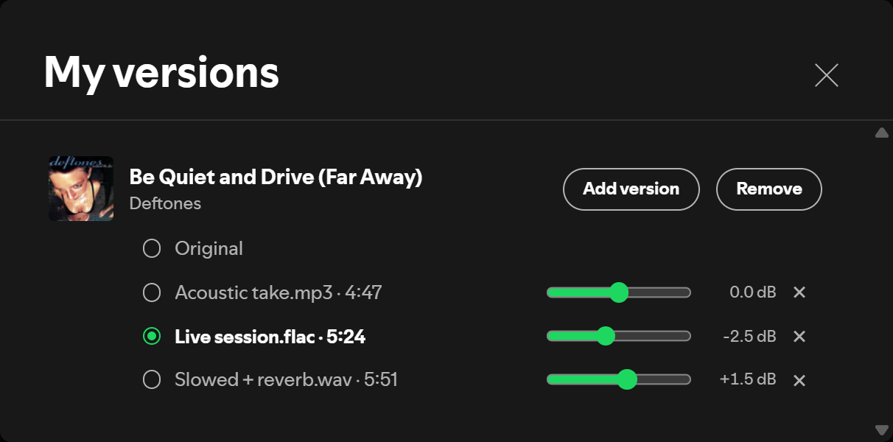

# My Version

A [Spicetify](https://spicetify.app) extension that replaces any Spotify song with your own audio file.
Whenever that song plays — from a playlist, an album, radio or the queue — your version plays instead.



## Features

- **Right-click a song → "Add my version…"** and pick an `mp3`, `wav`, `flac` or `ogg`/`opus` file.
- **Several versions per song.** Open **My versions** (♫ button in the top bar) and switch between them in one click.
  If the song is playing, it switches right away from the same spot, with a short crossfade.
- **"Original"** is always an option, so you can hear Spotify's track without deleting your versions.
- **Per-file volume** (−12…+12 dB) to match a file that is quieter or louder than your other songs.
- **The seek bar follows your file**: its length and position, whether it is longer or shorter than the original.
- Seeking and pausing fade like Spotify's own player (no clicks).
- The volume slider, mute, media keys, next/previous and repeat-one keep working as usual.
- Your files never leave your computer: they are stored inside Spotify's local storage.

## Install

**Marketplace:** open the Spicetify Marketplace, search for **My Version**, click *Install*.

**Manually:**

1. Download [`myVersion.js`](myVersion.js).
2. Put it into Spicetify's `Extensions` folder (`spicetify config-dir` opens the folder that contains it).
3. Run:
   ```
   spicetify config extensions myVersion.js
   spicetify apply
   ```

## Use

| To… | Do this |
|---|---|
| add a version | right-click a song → **Add my version…** |
| choose which version plays | **My versions** → click the version (or **Original**) |
| make a file louder or quieter | **My versions** → move the slider next to the file; click the dB value to reset it |
| play the song | **My versions** → click the song title |
| remove one version | **My versions** → **×** next to the file |
| remove all versions of a song | **Remove** in **My versions**, or right-click → **Remove my versions** |

## How it works

Spotify keeps playing the original track at volume 0, so the queue, buttons, media keys and Spotify Connect behave normally.
Your file is decoded with the Web Audio API and plays in its place; it is the real clock.
The extension rewrites the player state that Spotify's interface receives, so the seek bar shows your file's length
and position and the volume slider shows your volume instead of the muted original.

## Limitations

- Desktop app only, and only while music plays on this computer (not when Spotify Connect plays on another device).
- AAC/M4A files don't play: Spotify's built-in Chromium has no AAC decoder. Convert them to mp3 or flac.
- A version belongs to one Spotify track. The same song on another album or single needs its own version.
- Versions are stored per computer, inside Spotify's data folder. Reinstalling Spotify or clearing its data removes them, so keep your original files.
- The Windows media overlay still shows the original track's length.
- Tested with Spotify 1.2.89 and Spicetify 2.43.2. Spotify updates can change the internal APIs this relies on.

## License

[MIT](LICENSE)
